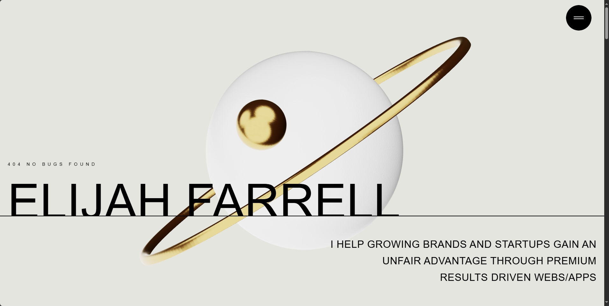

# 🌐 Nishant Verma — 3D Interactive Developer Portfolio

<div align="center">
  

  <br />

  [](https://react.dev/)
  [](https://vitejs.dev/)
  [](https://threejs.org/)
  [](https://greensock.com/)
  [](https://tailwindcss.com/)
  [](LICENSE)

  <p align="center">
    <strong>Computer Science Undergraduate • Full-Stack Developer</strong>
    <br />
    Building scalable web applications, robust backend systems & interactive 3D digital experiences.
  </p>

  <p align="center">
    <a href="https://github.com/Vermaji2077/3-d-Portfolio"><strong>Explore the Repository »</strong></a>
    <br />
    <a href="mailto:nishantv181@gmail.com">Contact Me</a>
    ·
    <a href="https://github.com/Vermaji2077">GitHub Profile</a>
    ·
    <a href="https://your-mart-by-nish.vercel.app/">Featured Project</a>
  </p>
</div>

---

## 👨‍💻 About Me

Hi! I'm **Nishant Verma**, a Computer Science student at **ITM (SLS) Baroda University (2023–2027)** with hands-on experience designing and building full-stack platforms, interactive learning visualizers, and e-commerce solutions.

- 🎓 **Education**: B.Tech in Computer Science & Engineering (ITM Baroda University)
- 💡 **Focus Areas**: Scalable Web Architecture, Full-Stack Development, RESTful APIs, 3D Web Graphics
- 🏅 **Certifications**: Code Unnati Program (AI & Foundations) & Advanced Emerging Technologies (Edunet Foundation & SAP)
- 📍 **Location**: Gujarat, India

---

## ✨ Portfolio Key Features

- **🪐 3D Celestial Hero Scene**: Custom Three.js Canvas featuring an interactive rotating planet and floating golden ring powered by `@react-three/fiber` and `@react-three/drei`.
- **📜 Lenis Smooth Scrolling**: Cinematic kinetic scrolling powered by `@studio-freight/lenis`.
- **🎯 Dynamic Scroll Animations**: GSAP ScrollTrigger timelines for reveal headers, staggered typography, and horizontal parallax word banners.
- **🗂️ Awwwards-Style Card Stacking**: Interactive skills section with sticky cascading card decks.
- **🖼️ Interactive Works Showcase**: Project cards featuring live links, tech stack badges, desktop hover clip-path reveals, and mobile preview cards.
- **📱 Fully Responsive**: Custom layout design crafted to look seamless across mobile devices, tablets, and high-res desktop monitors.
- **⚡ Built with Vite & React 19**: Ultra-fast hot module replacement, production chunk optimization, and modern React hooks.

---

## 🚀 Featured Projects

| Project | Description | Tech Stack | Links |
| :--- | :--- | :--- | :--- |
| **YourMart** | Full-stack grocery platform with product catalog, cart management, ordering, delivery tracking, OTP authentication, Stripe payments, and Inngest background workflows. | `React.js` `Node.js` `Express.js` `Neon Postgres` `Stripe` `Inngest` | [Live Demo ↗](https://your-mart-by-nish.vercel.app/) |
| **DSA Visualizer & AI Chatbot** | Interactive web application for visualizing data structures and algorithms with an integrated chatbot for real-time student assistance. | `JavaScript` `Python` `HTML5` `CSS3` | [Live Demo ↗](https://vermaji2077.github.io/dsa/) |
| **Aviation – Visa Consultancy** | Web platform for visa appointment scheduling, client consultancy management, user onboarding, and package tracking. | `React.js` `Node.js` `Express.js` `MySQL` | [Repository ↗](https://github.com/Vermaji2077/aviation) |
| **Modular Portfolio** | Highly adaptable and modular portfolio template designed for rapid client customization, dynamic content rendering, and clean UI. | `React.js` `JavaScript` `HTML5` `CSS3` | [Live Demo ↗](https://nish-modular-portfolio.vercel.app/) |
| **Echo** | Modern real-time communication platform featuring instant messaging, responsive modern UI, secure authentication, and seamless user experiences. | `React.js` `Node.js` `Tailwind CSS` `Express.js` | [Live Demo ↗](https://echo-by-nish.vercel.app/) |
| **3D Developer Portfolio** | Awwwards-inspired developer portfolio featuring interactive 3D WebGL scenes, smooth Lenis scrolling, and GSAP animations. | `React.js` `Three.js` `GSAP` `Tailwind CSS` | [Live Demo ↗](https://vermaji2077.github.io/Portfolio/) · [Repository ↗](https://github.com/Vermaji2077/3-d-Portfolio) |

---

## 🛠️ Technical Competencies

### Frontend
- **Languages & Frameworks**: JavaScript (ES6+), React.js, Vite, HTML5, CSS3
- **Styling**: Tailwind CSS v4, Modern Responsive Layouts
- **3D & Animation**: Three.js, React Three Fiber (`@react-three/fiber`), Drei, GSAP, ScrollTrigger, Framer Motion

### Backend & Databases
- **Runtime & Servers**: Node.js, Express.js, RESTful API Design
- **Databases**: MySQL, Neon Serverless Postgres, MongoDB
- **Workflows & Services**: Inngest (Event-Driven Background Jobs), Stripe Payments, Cloudinary, Brevo

### Tooling & Environments
- Git, GitHub, VS Code, Postman, Streamlit

---

## 📜 Education & Certifications

- **B.Tech in Computer Science & Engineering** — ITM (SLS) Baroda University *(June 2023 – May 2027)*
- **Advanced Course in Emerging Technologies** — Edunet Foundation & SAP *(2025 – 2026)*
  - Neural networks, deep learning model training, edge computing, SAP Analytics Cloud, and SAP ABAP on BTP.
- **Code Unnati Program — AI & Foundations** — Edunet Foundation & SAP *(2024 – 2025)*
  - Python, C++ OOP, conversational AI chatbots, and algorithmic problem-solving.
- **Class XII (Science Stream)** — Mar Gregorios Memorial School *(March 2023)*

---

## 📦 Setup & Local Development

### Prerequisites
- Node.js (v18 or higher recommended)
- npm, yarn, or pnpm

### Installation

1. **Clone the repository**:
   ```bash
   git clone https://github.com/Vermaji2077/3-d-Portfolio.git
   cd 3-d-Portfolio
   ```

2. **Install dependencies**:
   ```bash
   npm install
   ```

3. **Start the development server**:
   ```bash
   npm run dev
   ```

4. **Build for production**:
   ```bash
   npm run build
   ```

5. **Preview production build**:
   ```bash
   npm run preview
   ```

---

## 📬 Get in Touch

- 📧 **Email**: [nishantv181@gmail.com](mailto:nishantv181@gmail.com)
- 📱 **Phone**: [+91 8980264859](tel:+918980264859)
- 🐙 **GitHub**: [@Vermaji2077](https://github.com/Vermaji2077)
- 📄 **Resume**: Available for download in the navigation drawer and contact section

---

<div align="center">
  <sub>Designed & Developed by Nishant Verma. All rights reserved.</sub>
</div>
